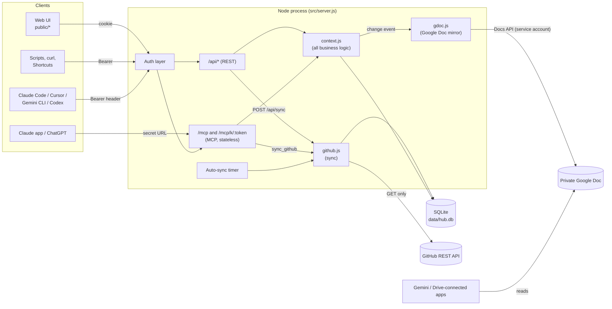
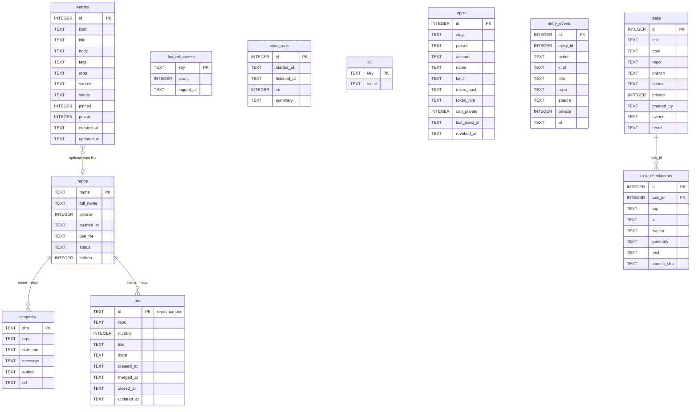
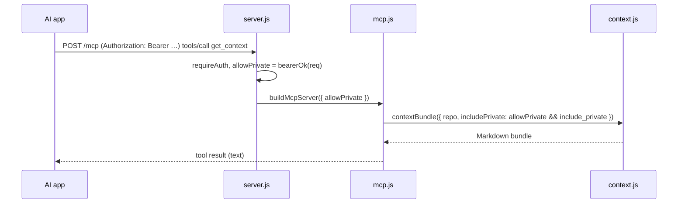
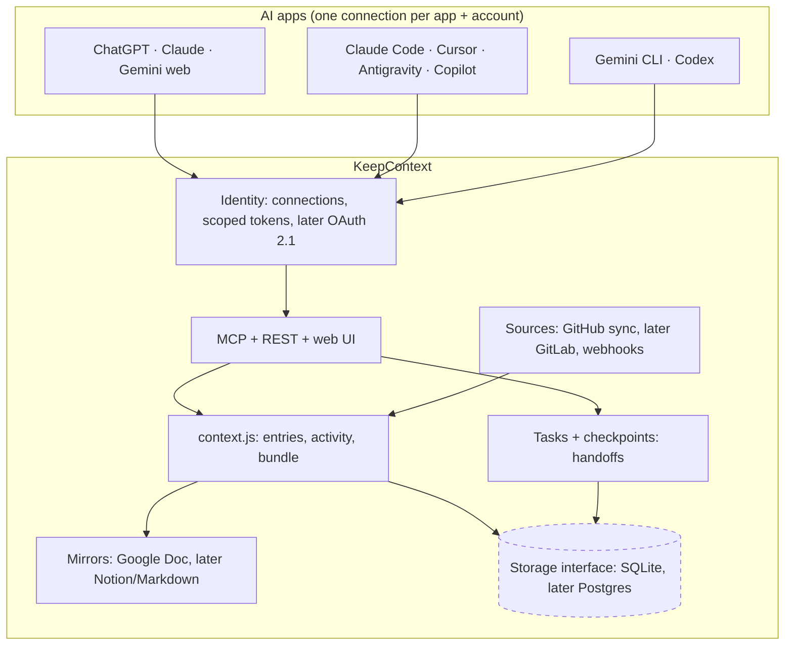

# KeepContext: architecture and codebase guide

How the app is built, why, and where to change things. Keep this file current: any change to behaviour, schema, routes, MCP tools, config or file layout updates this doc in the same commit (see the rule in `CLAUDE.md`).

*Last updated: 2026-10-20 (v1.1.0: per-app connections and verified attribution; handoff design and proposed architecture).*

---

## 1. What it is

A small, self-hosted Node server that keeps one shared memory for all your AI apps:

- **Reads** your GitHub activity (repos, default-branch commits, pull requests). Read-only, never writes to GitHub.
- **Stores** your own context: ideas, notes, decisions, todos, standing instructions and profile facts.
- **Serves** both to every AI app through one **MCP server**, plus a **web UI** and a **REST API**. All three call the same functions, so they always agree.

- **Mirrors** the public bundle into a private **Google Doc**, so Gemini and other Drive-connected apps can read it (optional).

One process, one SQLite file, no build step, three runtime dependencies (`express`, `@modelcontextprotocol/sdk`, `zod`).

## 2. System overview

**Layering rule:** `server.js` (HTTP) and `mcp.js` (MCP) are thin. They parse input, check auth and call `context.js` or `github.js`. Business logic lives only in `context.js`, so the UI, REST and MCP behave the same.

## 3. Codebase map

| Path | Role | Key exports / contents |
| --- | --- | --- |
| `src/config.js` | Loads `.env` (tiny built-in loader; real env vars win), builds `config`. Everything is optional; exits only if `HUB_TOKEN` is set but shorter than 16 chars | `config` |
| `src/settings.js` | Settings made in the UI, stored in `kv`, filled into `config` where `.env` is empty: first-run setup (`setupNeeded()`, `completeSetup()`, setup code), admin password (scrypt) and admin token (SHA-256), session secret, profile (name, timezone), GitHub token (`connectGithub()`, pre-filled token link) | `setupNeeded()`, `completeSetup()`, `isAdminToken()`, `isAdminPassword()`, `sessionValue()`, `updateSettings()`, `connectGithub()`, `disconnectGithub()`, `rotateAdminToken()`, `changePassword()`, `publicSettings()` |
| `src/demo.js` | `DEMO=1`: completes setup with a demo password and fills an empty hub with a fictional person (entries from several apps, a handed-off task, GitHub-like activity) | `seedDemo()`, `DEMO_PASSWORD` |
| `src/db.js` | Opens `data/hub.db` with `node:sqlite`, creates tables, runs guarded column migrations, change events | `db`, `now()`, `kvGet()`, `kvSet()`, `changes`, `notifyChange()` |
| `src/github.js` | GitHub client (`fetch`, pagination via `Link` header) and `syncGithub()` | `syncGithub()` |
| `src/context.js` | All queries and formatting: activity log (GitHub + context changes), entries CRUD/search with change history, projects, the agent bundle, work log table, repo context files, overview dashboard data, Google Doc content | `activity()`, `workLogRows()`, `markLogged()`, `projects()`, `updateProject()`, `createEntry()`, `updateEntry()`, `deleteEntry()`, `listEntries()`, `contextBundle()`, `repoContextFiles()`, `overview()`, `syncRuns()`, `syncHealth()`, tasks (`startTask()`, `checkpointTask()`, `listTasks()`, `getTask()`, `resumeTask()`, `finishTask()`, `reopenTask()`), `isGithubRow()`, `mirrorModel()`, connections (`APP_PRESETS`, `createApp()`, `listApps()`, `rotateApp()`, `revokeApp()`, `findAppByToken()`, `touchApp()`), `localDay()`, `KINDS` |
| `src/gdoc.js` | Google Doc mirror: service-account sign-in (keyless via the VM metadata server, or a JSON key with a JWT signed by `node:crypto`), renders `mirrorModel()` into Docs formatting requests (`renderDoc()`), debounced auto-push on change events | `startGdocMirror()`, `pushGdoc({ force })`, `gdocStatus()`, `renderDoc()` |
| `src/mcp.js` | Builds an MCP server per request and registers the 17 tools (zod input schemas, annotations), including the five task tools | `buildMcpServer({ allowPrivate, caller })` |
| `src/server.js` | Express app: auth, rate limits, login/logout, MCP routes, REST routes, static UI, auto-sync timer | (entry point) |
| `src/ratelimit.js` | In-memory fixed-window counters (no dependency) used by `server.js` for failed logins, wrong tokens and requests per app | `limiter({ limit, windowMs })` |
| `public/index.html` | The single-page UI: 8 tabs (Overview with a Get started checklist, Context, Tasks, Activity log with CSV export, Projects, Apps, Repo files, Settings) | |
| `public/app.js` | Vanilla JS for the UI: `api()` fetch wrapper, tab loaders, Overview dashboard, entry cards (Markdown details, source badge, show more), client-side filters (search, kind, status, source app, tag chips). Context tab layout: filtered list first, add/edit form in a sticky side column, full-width agent-bundle preview below; Overview metric cards open the matching list, Markdown renderer (`mdToHtml`), `esc()` for escaping | |
| `public/style.css` | Light/dark theme via CSS variables, layout helpers (`.row`, `.grid2`, `.card`, `.pill`) | |
| `public/login.html` | Password form posting to `/login` (shows the password in demo mode) | |
| `public/setup.html` | First-run setup form (setup code, name, timezone from the browser, password); shows the admin token once | |
| `scripts/sync.mjs` | `npm run sync`: one sync from the CLI or cron | |
| `scripts/backup.sh` | Consistent snapshot of the live database (SQLite `VACUUM INTO`), integrity-checked, newest 14 kept on the VM; `--stdout` for the nightly workflow |
| `scripts/restore.sh` | Swap a snapshot back in on the server: check it, stop, keep the current DB as pre-restore, start, `/healthz`, undo on failure |

| `scripts/connect-app.sh` | Put a connection token into one local app's config (Claude Code, Cursor, Antigravity, Gemini CLI, Codex, Copilot) without printing it. Also served by the hub at `GET /connect.sh` (public, no secrets, this hub's URL baked in) for `curl … \| bash -s <app>` |
| `docs/CONNECT_APPS.md` | User guide: connections, per-app setup, rotate/revoke, troubleshooting |
| `docs/HANDOFF_PLAN.md` | Design and rationale of continue-anywhere handoffs |
| `scripts/rotate-token-local.sh` | After a `HUB_TOKEN` change on the server: reads the new token invisibly, checks it against the live hub, updates the laptop's MCP configs (repo `.env`, `~/.config/keepcontext/env`, Antigravity, Cursor, Claude Code) and lists the manual steps |
| `AGENTS.md` | Short rules for non-Claude agents: use the MCP tools for live data, never a local database, never print secrets |
| `scripts/deploy.sh` | Update a server install: lock, fetch, fast-forward to `origin/main`, `npm ci` only if dependencies changed, restart, `/healthz` check, automatic rollback |
| `.github/workflows/release.yml` | On a `vX.Y.Z` tag: tests, checks the tag matches `package.json`, publishes a GitHub Release with that version's `CHANGELOG.md` section |
| `CHANGELOG.md` | Version history (Keep a Changelog, SemVer); `[Unreleased]` collects changes until the next release |
| `.github/workflows/ci.yml` | Tests on Node 22, 24 and 26 for every push and pull request, and the Docker image starts healthy |
| `scripts/vm-setup.sh` | Server setup on a Debian/Ubuntu VM: Node 22, swap, `npm ci`, systemd service `keepcontext` |
| `scripts/inject.mjs` | `npm run inject -- <dir>`: writes AGENTS.md / CLAUDE.md / GEMINI.md / Cursor rule into a **local** folder; never commits | |
| `test/hub.test.mjs` | End-to-end `node:test` suite: starts the fake GitHub and the hub as child processes, drives REST and MCP | |
| `test/mock-google.mjs` | Fake Google token endpoint and Docs API; verifies the JWT signature and keeps the Doc text in memory (`GET /_doc`) | |
| `test/mock-github.mjs` | Fake GitHub API (Express) with fixed repos, commits and PRs; token must be `ghtest`. `POST`/`DELETE /_fail/<repo>` makes a repo's commits fail (tests for sync errors) | |
| `docs/` | This guide, `CONNECT_APPS.md` (connecting each AI app), `SELF_HOSTING.md` (Docker, tunnels, VPS, backups), `HANDOFF_PLAN.md` (continue-anywhere design), `images/` (README screenshots from demo mode) | |
| `CONTRIBUTING.md`, `SECURITY.md`, `CODE_OF_CONDUCT.md`, `.github/ISSUE_TEMPLATE/`, `.github/PULL_REQUEST_TEMPLATE.md`, `.github/dependabot.yml`, `.github/workflows/codeql.yml` | Community files: how to develop and release, private vulnerability reporting, templates, dependency updates, code scanning | |
| `Dockerfile`, `docker-compose.yml`, `docker/` | Container image (non-root, health check) and compose file with optional tunnel profiles (`quick-tunnel`, `tailscale`) | |
| `.github/workflows/docker.yml` | On a version tag: multi-arch image to GitHub Container Registry | |
| `.mcp.json` | Connects Claude Code in this folder to the local hub (`${HUB_TOKEN}` from the shell) | |
| `CLAUDE.md`, `TODO.md` | Rules for agents working on this repo; roadmap | |

## 4. Data model (`data/hub.db`)

| Table | Holds | Notes |
| --- | --- | --- |
| `repos` | One row per GitHub repo | `use_for`, `status`, `hidden` are yours; sync never overwrites them |
| `commits` | Default-branch commits | `INSERT OR IGNORE` by `sha`, so re-syncing is safe. Merge commits are stored but skipped by the activity log |
| `prs` | Pull requests | Upserted by `repo#number` |
| `entries` | Your context | `kind` ∈ idea, note, instruction, decision, todo, profile. `tags` is comma-separated lower case. `status` open / done / archived. `private` hides it from agents (section 6) |
| `logged_events` | Activity rows already copied to your work log | Stores the row's `count`; if a day gains more commits later, the row shows as not logged again |
| `sync_runs` | History of syncs with a JSON summary (`repos`, `reposChanged`, `newCommits`, `prsTouched`, `errors`, `error`) | Newest 500 kept. Last run in `/api/status` (`sync.lastRun`); list in `GET /api/sync-runs` and the Activity tab |
| `apps` | Connections: one per app and account (`preset` = which app, `account` = your label, `name` = "ChatGPT · work") | Only the SHA-256 hash of the token is stored. Revoked rows stay for history |
| `entry_events` | Every context change: `added`, `updated`, `done`, `reopened`, `archived`, `pinned`, `unpinned`, `deleted`, with who did it (`source`: the app for adds, `web` for UI edits, `agent` for MCP edits) | Snapshots of kind/title/repo/private, so rows stay readable after edits or deletes. Feeds the Context activity rows and the Overview |
| `tasks` | Continue-anywhere tasks: title, goal, repo, branch (default `wip/<id>-<title>`), status `active` / `done` / `abandoned`, `private`, `created_by` and `owner` (connection slugs) | Private by default when `repo` isn't a synced repo (company work), unless created over the secret URL |
| `task_checkpoints` | Append-only progress notes per task: app (verified), reason (`start`, `step`, `limit-warning`, `resumed`, `finished`, `abandoned`, `reopened`), summary, JSON lists `done` / `next` / `files` / `decisions` / `questions`, `commit_sha`, `branch` | `resumed` rows mark handoffs (only when the owner changes); they're hidden from the history agents get |
| `kv` | Settings from the UI (`admin_password`, `admin_token_sha256`, `session_secret`, `owner_name`, `timezone`, `github_token`, `github_login`), `last_sync_at`, `github_owner`, `sync_retry` (repos whose last fetch failed → where to fetch from again), `gdoc_last_push_at`, `gdoc_last_hash` | |

**Migrations:** new columns are added in `db.js` with `ALTER TABLE … ADD COLUMN`, guarded by `hasColumn()`, so old `hub.db` files keep working. Never drop or rename columns.

## 5. Main flows

### 5.1 GitHub sync (`syncGithub()` in `github.js`)

1. Concurrent calls share one run (`running` promise).
2. `since` = last sync minus 1 hour of overlap, or `SYNC_WINDOW_DAYS` back on the first run.
3. List repos: `/users/:owner/repos`, then add private ones from `/user/repos` (owner match). Forks are skipped unless `INCLUDE_FORKS=true`.
4. Upsert every repo. Skip commit and PR calls for repos whose `pushed_at` is older than `since`, unless the repo is in `sync_retry`. An idle sync is ~2 API calls.
5. For changed repos: commits on the default branch since `since` (up to 10 pages), and PRs sorted by `updated` (stop at the first one older than `since`, max 5 pages). A `409` (empty repo) returns nothing. Per-repo errors go into `summary.errors`; the sync continues.
6. A repo that failed is saved in `kv.sync_retry` with the `since` it needed; later runs fetch it from that point (even if it wasn't pushed again) until it works, so `last_sync_at` moving on never skips its commits.
7. Save `last_sync_at`, record the run in `sync_runs` (newest 500 kept).

Errors are visible: the UI header and the Overview Status card show "Sync failed" or "N repo errors" from `sync.lastRun` in `/api/status` (refreshed when the page becomes visible again), and the Activity tab lists recent runs (`GET /api/sync-runs?notable=1`: failed runs, runs with errors or new commits).

Triggers: the **Sync GitHub** button (`POST /api/sync`), the `sync_github` MCP tool, `npm run sync`, and the timer in `server.js` (every `AUTO_SYNC_MINUTES`, first run 10 s after start; logs only when something changed or failed).

### 5.2 Activity log (`activity()` in `context.js`)

- Dates are converted to `TIMEZONE` (default UTC) with `Intl.DateTimeFormat`.
- **Commits:** one row per local day per repo. Merge commits (`Merge pull request…`, `Merge branch…`) are skipped. The summary joins first lines with conventional-commit prefixes stripped; repeated messages appear once with `(×N)`; capped at 160 chars.
- **PRs:** one row per event: `PR opened`, then `PR merged` or `PR closed`.
- Stable keys: `commits:<repo>:<date>`, `pr-opened:<repo>:<n>`, `pr-merged:…`, `pr-closed:…`.
- **Context changes:** one `Context` row per local day (key `context:<date>`, repo `KeepContext`), summarising every change from `entry_events`, e.g. `3 changes: added idea "X" (chatgpt); marked done todo "Y" (web)`. Identical changes collapse to `(×N)`. Events for entries that were or are private are left out. Context rows are excluded from the work log table (`workLogRows`, `get_unlogged_activity`, Copy as table) and from the agent bundle's activity section, and are skipped when a `repo` filter is given.
- Sorted newest day first, then newest time.

### 5.3 An agent loads context (`get_context`)

The MCP transport is **stateless** (`sessionIdGenerator: undefined`, JSON responses): a new `McpServer` per POST, no session store. That keeps it simple to host and restart.

**Bundle sections** (`contextBundle()`): Profile → Standing instructions (not archived) → Notes for the repo (if `repo` given) → Pinned → Recent ideas (open) → Recent decisions → Open todos → Projects (top 15 by push) → Repo activity (14 days, 40 rows) → reminder to use `save_entry`. Notes are not a bundle section; agents find them with `search_context`, or you pin them.

### 5.4 Saving context

`save_entry` (MCP), `POST /api/entries` (REST, `source` defaults to `web`) and the UI form all call `createEntry()`. Edits go through `updateEntry()`. Every create, update or delete of an entry, every project-note change, and every sync that saw changed repos calls `notifyChange()` (an `EventEmitter` in `db.js`).

### 5.5 Google Doc mirror (`gdoc.js`)

1. On start (`startGdocMirror()`, only if `GOOGLE_DOC_ID` is set and the key file exists): push once after 5 s, then listen for change events.
2. Each change restarts a timer (`GDOC_DEBOUNCE_SECONDS`, default 30). When it fires, `pushGdoc()` builds `mirrorModel()` (public entries only): title, last-updated line, contents list, then Profile, Standing instructions, Pinned, Open todos, Ideas, Decisions, Notes, Done and archived, all Projects, and 30 days of activity grouped by day. `renderDoc()` turns it into one text insert plus formatting requests (TITLE/HEADING styles, bullet lists, bold titles, grey italic metadata, links), after resetting old styles.
3. If the content (ignoring the last-updated line) hashes the same as the last push (`kv.gdoc_last_hash`), nothing is written.
4. Otherwise get an access token (cached ~1 h): **keyless** (no key file) from the VM metadata server, where the VM runs as a service account with only the `documents` scope; or **key file** by signing a JWT (`RS256`, scope `documents`) and exchanging it at Google's token endpoint. Then read the Doc's end index, then one `batchUpdate`: delete the old body and insert the new text.
5. **Push now** in the UI (`POST /api/gdoc/push`) forces a write. Errors are kept in `gdocStatus().lastError` and shown in the UI; the key and tokens are never logged.

### 5.6 Continue-anywhere tasks (`startTask()` … `resumeTask()` in `context.js`)

Design and rationale: `docs/HANDOFF_PLAN.md`. An app that hits its usage limit can't save anything, so apps checkpoint **after each step**, and the code lives on the task's git branch (the hub stores the branch and commits, never code).

1. `start_task` creates the task, a branch name and a `start` checkpoint; the caller becomes the owner.
2. `checkpoint_task` appends a checkpoint (summary, next steps, files, decisions, questions, commit; `reason: limit-warning` when near a limit) and makes the caller the owner. Refused on finished tasks until reopened.
3. Every app sees open tasks in `get_context` (an "Open tasks" section with the last app, its summary and the next step) and through `list_open_tasks`.
4. `resume_task` (by id, or the newest open task, optionally per repo) returns a Markdown brief: goal, where the last app stopped and its next steps, open questions, `git switch <branch>`, history (oldest first, without `resumed` rows), and for an app that worked on it before: what others did since its own last checkpoint plus `git diff <its last commit>..HEAD`. It warns if another app checkpointed in the last 10 minutes. If the task changes hands it records a `resumed` checkpoint and moves the owner; for a finished task it is a review only. `checkpoint_task` from an app that isn't the owner records the same `resumed` row first, so a handoff shows even when the app skipped `resume_task`. `commit` is kept only if it looks like a commit hash (7–40 hex characters); `HEAD` or a branch name is dropped.
5. `finish_task` (done or abandoned, with a result). The UI can reopen.

Visibility (`canSeeTask()`): public tasks for everyone; private ones for the web UI, callers allowed private context (header + private access), and connections that worked on the task, never over the secret URL. Activity: one `Task` row per task per day (`task:<id>:<date>`, apps in order, checkpoint count), never for private tasks and never in the work log rows (`isGithubRow()`). UI: **Tasks** tab (filter by status, timeline per task with app badges, done / abandon / reopen), Overview **Active tasks** card (idle after 2 hours without a checkpoint).

## 6. Security model

Every request is resolved to a **caller** (`resolveCaller()` in `server.js`): `web` (session cookie), `admin` (the shared `HUB_TOKEN`, recorded as "Shared token"), or `app` (a **connection** token: one per app and account, e.g. "ChatGPT · work"). The caller's slug is written on every change (`entries.created_by` / `updated_by`, `entry_events.app`), so attribution comes from the credential, not from what a model writes.

| Channel | How it authenticates | Used by | Allowed | Private entries |
| --- | --- | --- | --- | --- |
| Web UI | `hub_session` cookie after `/login` with `ADMIN_PASSWORD` | You in a browser | Everything | Visible (lock badge) |
| REST `/api/*` with `HUB_TOKEN` | `Authorization: Bearer` or `X-Hub-Token` | Scripts, old configs | Everything | Same as the UI |
| REST `/api/*` with a connection token | `Authorization: Bearer chub_…` | Shortcuts, quick capture | Only `GET /context`, `GET/POST /entries`, `PATCH /entries/:id` (403 otherwise) | Only if the connection has private access |
| MCP `/mcp` | `Authorization: Bearer` with `HUB_TOKEN` or a connection token | Claude Code, Cursor, Antigravity, Gemini CLI, Codex, Copilot, Claude Pro (header) | All 17 tools | Only with `include_private: true`, the header, and (for connections) private access |
| MCP `/mcp/k/:token` | Shared or connection token in the URL path | ChatGPT, Claude web, Gemini web (URL-only connectors) | All 17 tools | Never, and `update_entry` can't touch them |

Connections (`apps` table, Apps tab, `/api/apps`, admin-only): tokens are `chub_` + 32 random bytes, stored only as SHA-256 hashes, shown once on create/rotate. Rotate replaces the token at once; revoke disables it; `last_used_at` is updated at most once a minute.

Details:

- Token and password checks use `crypto.timingSafeEqual` (`safeEq`). A failed login waits 800 ms.
- **First-run setup** (no `HUB_TOKEN` in `.env` and none stored): only `/`, `/setup`, `/healthz` and static files work; `/api` and `/mcp` answer 503. Finishing setup needs the **setup code** printed in the server log (`SETUP_CODE` to fix it), so whoever reaches a freshly exposed hub first can't claim it; wrong codes count as failed logins. The password is stored as scrypt with a salt, the admin token only as SHA-256, both in `kv`.
- **GitHub token from the UI** is checked against `GET /user` and stored in `kv` (like `.env`, the database file is the secret store; never returned by any route). The Connect link pre-fills a fine-grained token with read-only Contents, Pull requests and Metadata.
- Rate limits (`src/ratelimit.js`, in memory, reset on restart; `0` turns one off):
  - **Failed logins:** `LOGIN_MAX_FAILS` (10) per IP and `LOGIN_MAX_FAILS_TOTAL` (50) in total per 15 minutes. Checked before the password, so a guess while blocked reveals nothing; the login page says to wait. Browsers already signed in are unaffected.
  - **Wrong tokens or cookies** on `/api`, `/mcp` and `/mcp/k/:token`: `BAD_TOKEN_MAX` (30) per IP per 15 minutes, then `429` with `Retry-After`. A valid token is never refused by this, so guessing from a shared IP can't lock the real apps out.
  - **Requests per caller** (connection slug, `shared-token` or `web`, not IP): `RATE_LIMIT_PER_MINUTE` (600), then `429`. Stops one runaway agent from flooding the hub.
  - The client IP comes from `X-Forwarded-For` only when the connection is from a trusted proxy (`TRUST_PROXY`, default `loopback`: Tailscale Funnel, cloudflared, Caddy on the same machine), so clients can't fake it.
- The session cookie is stateless: `HMAC-SHA256(ADMIN_PASSWORD, 'ui-session:' + HUB_TOKEN)` with `.env` secrets, or `HMAC-SHA256(session_secret, 'ui-session:' + password hash)` after the setup page, `HttpOnly`, `SameSite=Lax`, 30 days, `Secure` behind HTTPS. Changing either secret signs everyone out.
- Private entries: `listEntries()` and `contextBundle()` exclude them unless `includePrivate: true`; `updateEntry()` treats them as missing unless `includePrivate: true`. `canSeePrivate(caller)` decides: the web UI always; the shared token or a connection with private access only over the `Authorization` header.
- `/api/status` never returns secrets. Nothing logs tokens.
- Every response sends `X-Content-Type-Options: nosniff`. The REST `repo` parameter must be a repository name (`[A-Za-z0-9._-]`, 400 otherwise), so it is never echoed as markup.
- GitHub is read-only: only `GET` requests; the token needs read scopes only.
- User data (commit messages, PR titles, entry text) is escaped in the UI with `esc()`, including in the Markdown preview, and is never treated as instructions.
- `/mcp` allows CORS from any origin (auth is still required).
- Google Doc mirror: on a Google Cloud VM it can be keyless: the VM runs as a dedicated service account with only the `documents` scope, which can edit only Docs shared with it (and replaces the default compute account's broad rights). If a key file is used instead (`google-sa.json`, git- and docker-ignored, `chmod 600`), it has the same limits. The Doc never contains private entries. Anyone the Doc is shared with can read everything public in the hub, so keep it shared with yourself and the service account only.

## 7. Configuration

| Variable | Default | Purpose |
| --- | --- | --- |
| `HUB_TOKEN` | empty (setup page makes one) | Admin secret for REST and MCP (≥16 chars) |
| `ADMIN_PASSWORD` | `HUB_TOKEN`, else set on the setup page | Web UI password |
| `SETUP_CODE` | random, printed in the log | Code the first-run setup asks for |
| `DEMO` | off | `1` fills an empty hub with a fictional person |
| `GITHUB_TOKEN` | empty (Settings → Connect GitHub) | Fine-grained, read-only token. Without it, sync is off |
| `GITHUB_OWNER` | token's account | Whose repos to sync |
| `GITHUB_API_URL` | `https://api.github.com` | Point at the fake GitHub for tests |
| `SYNC_WINDOW_DAYS` | 60 | First-sync backfill |
| `AUTO_SYNC_MINUTES` | 5 | Sync interval (0 = off); wins over `AUTO_SYNC_HOURS`. Runs only while GitHub is connected |
| `AUTO_SYNC_HOURS` | 0 | Older, coarser interval |
| `INCLUDE_FORKS` | false | Sync forks too |
| `TIMEZONE` | UTC (setup page / Settings tab) | Activity-log dates (IANA name) |
| `PUBLIC_URL` | empty: the address the request came in on | Base URL in Apps-tab snippets, `/connect.sh` and repo files. Set it if the hub is reached through a proxy elsewhere |
| `PORT` | 8787 | HTTP port |
| `OWNER_NAME` | empty (Settings tab) | Your name in the bundle heading and repo files |
| `DATA_DIR` | `./data` (`/data` in Docker) | Where `hub.db` lives |
| `GOOGLE_DOC_ID` | empty (mirror off) | The Doc to keep in sync (the long ID in its URL) |
| `GOOGLE_SA_KEY_FILE` | `./google-sa.json` | Service-account JSON key; if the file doesn't exist, keyless mode (metadata server) is used |
| `GDOC_DEBOUNCE_SECONDS` | 30 | Wait after the last change before pushing |
| `GOOGLE_TOKEN_URL`, `GOOGLE_DOCS_API_URL`, `GOOGLE_METADATA_URL` | Google's | Test overrides (fake Google) |
| `TRUST_PROXY` | `loopback` | Express `trust proxy`: which proxies may set the client IP and HTTPS flag |
| `LOGIN_MAX_FAILS` / `LOGIN_MAX_FAILS_TOTAL` | 10 / 50 | Failed logins per IP / in total per 15 min (0 = off) |
| `BAD_TOKEN_MAX` | 30 | Wrong tokens per IP per 15 min before `429` (0 = off) |
| `RATE_LIMIT_PER_MINUTE` | 600 | Requests per minute per app (0 = off) |

## 8. Testing

- `npm test` runs `test/hub.test.mjs` with `node:test`. It starts `test/mock-github.mjs` (port 19911), `test/mock-google.mjs` (port 19912) and the hub (port 18799) as child processes with a temp `DATA_DIR`, a random `HUB_TOKEN` and admin password, and a throwaway RSA service-account key per run.
- Covered: connections (two accounts of one app, verified attribution even when the model reports another source, private access only with permission and the header, scoped REST, rotate/revoke, last used), auth rejection, first and incremental sync, activity grouping (merge commits skipped, `×N`), mark-logged, entries CRUD/search, project notes surviving syncs, MCP over Bearer and secret URL, private entries on every channel, Google Doc mirror (push, debounced auto-push, no private entries, content replaced not appended, keyless mode), repo context files.
- CI runs the same suite on Node 22, 24 and 26 for every push and pull request (GitHub Actions).
- Not covered by tests: the browser UI (check it by hand: it should load without console errors).

## 9. Deployment

- **Docker (main install path):** `node:26-slim` (current LTS), production dependencies only, runs as the unprivileged `node` user, `HEALTHCHECK` on `/healthz`, OCI labels, data in the `/data` volume; SIGTERM closes the HTTP server and the database. Published for amd64 and arm64 to `ghcr.io/darshanbajgain/keepcontext` on every version tag (`.github/workflows/docker.yml`); CI builds it and checks that it starts healthy. `docker-compose.yml` runs it locally, plus optional profiles `quick-tunnel` (Cloudflare quick tunnel: instant public HTTPS, new address on every restart) and `tailscale` (Tailscale Funnel: fixed `https://keepcontext.<tailnet>.ts.net`, needs `TS_AUTHKEY`, config in `docker/tailscale-funnel.json`). The tunnel containers share the hub's network namespace, so they reach it on 127.0.0.1 and count as a trusted loopback proxy (client IP and `Secure` cookies work). Any host with a persistent volume works (VPS, home server, Raspberry Pi, Railway, Render, Fly.io); serverless hosts without a disk don't.
- **Plain Node on a VM:** `scripts/vm-setup.sh` installs Node and a systemd service; `scripts/deploy.sh` updates it (health check and rollback).
- **HTTPS without Docker's tunnels:** put it behind a reverse proxy or tunnel on the same machine (Caddy, cloudflared, Tailscale Funnel). Express trusts a proxy on the same machine (`TRUST_PROXY=loopback`); set `TRUST_PROXY` if the proxy runs elsewhere, and `PUBLIC_URL` if the detected address is wrong.
- Health check: `GET /healthz` → `{"ok":true}`.
- Backups: `scripts/backup.sh` takes a consistent snapshot (keeps the newest 14; `--stdout` to stream it elsewhere, e.g. from a scheduled job, then encrypt it); `scripts/restore.sh` swaps one back with a health check and automatic undo. `/api/export` leaves private entries out, so it isn't a backup.

## 10. Design decisions

| Decision | Why | Trade-off |
| --- | --- | --- |
| One Node process, `node:sqlite`, no ORM | Zero native builds, one file to back up | `node:sqlite` is marked experimental in Node 22 |
| Business logic only in `context.js` | UI, REST and MCP can't drift apart | Wrappers stay deliberately dumb |
| Stateless MCP over Streamable HTTP | No session store; restarts and redeploys are safe | A new MCP server object per request (cheap) |
| Secret URL in addition to Bearer | Claude app and ChatGPT connectors only take a URL | The URL is a credential; it never unlocks private entries |
| Polling every few minutes, not webhooks | Works on localhost; personal GitHub accounts have no account-wide webhook | Up to `AUTO_SYNC_MINUTES` delay |
| Vanilla JS UI, no bundler | Nothing to build, easy to read | Hand-written DOM code |
| Read-only GitHub | Safety: the hub can't damage repos | Repo files are written locally by `inject.mjs`, committed by you |

## 11. How to extend

- **New MCP tool:** add the logic to `context.js`, register it in `mcp.js` with a zod schema and `annotations` (`readOnlyHint: true` for reads), add a REST route in `server.js` if the UI needs it, add a test, update section 3/5 here and the README tool table.
- **New column:** add a guarded `ALTER TABLE` in `db.js`, map it in `rowOut()` if it's on `entries`, update section 4.
- **New config option:** read it in `config.js`, add it to `.env.example` and section 7.
- **New UI feature:** markup in `index.html`, logic in `app.js` (escape all user data with `esc()`), styles with the existing CSS variables.

## 12. Planned changes and proposed architecture

See `TODO.md`. Left from `docs/HANDOFF_PLAN.md`: an MCP `resume` prompt, compare links per checkpoint, public tasks in the Google Doc. Hardening still open: OAuth 2.1 for MCP.

Target architecture (same single process for self-hosting; the dashed parts are new):

Principles that stay: business logic only in `context.js` (and a future `tasks.js`), thin MCP/REST wrappers, verified attribution on every write, private by default for sensitive data, GitHub read-only, one process + one database file for self-hosters.

## 13. Change log

- **2026-11-05:** Tasks: `checkpoint_task` by a non-owner records the handoff (`resumed`); checkpoint commits must be hashes.
- **2026-11-04:** v1.0.1: `repoParam()` validation and `nosniff` (CodeQL findings).
- **2026-11-04:** v1.0.0, first public version (see `CHANGELOG.md`).
